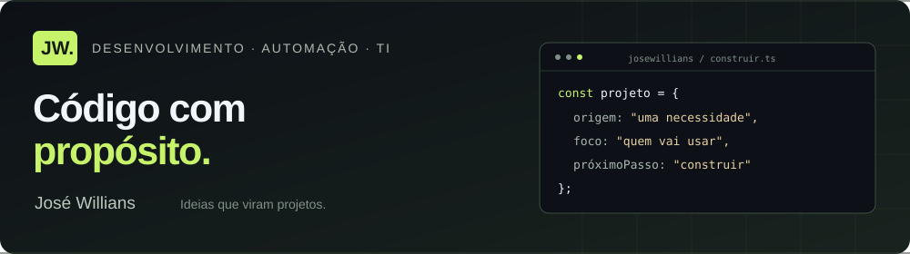
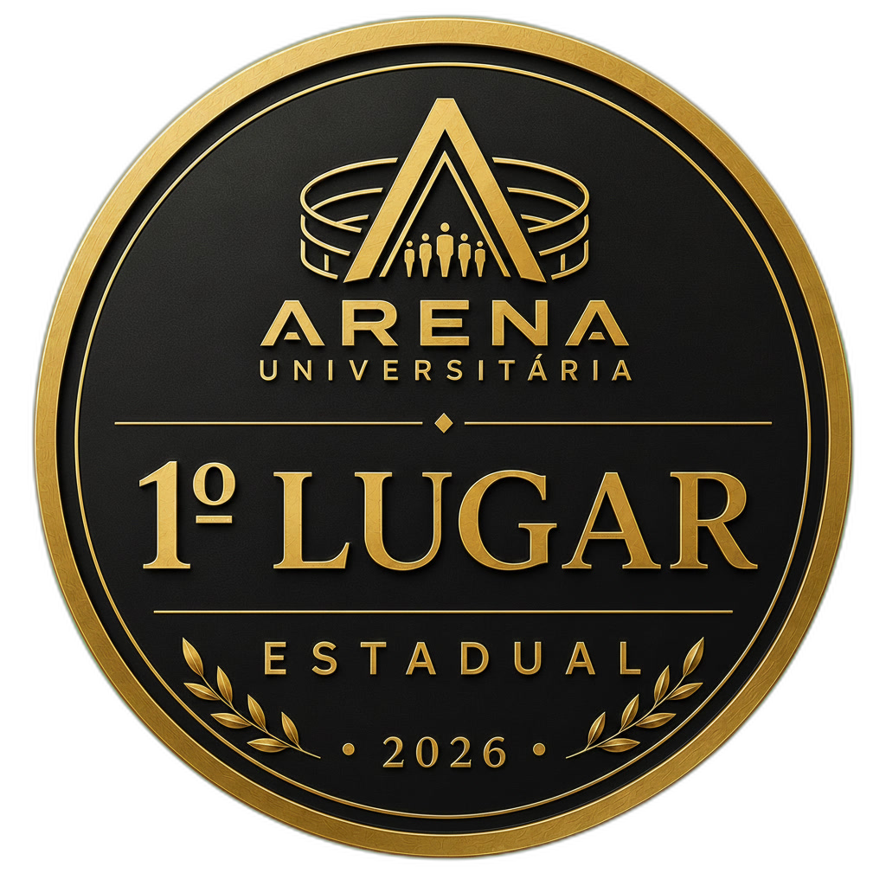
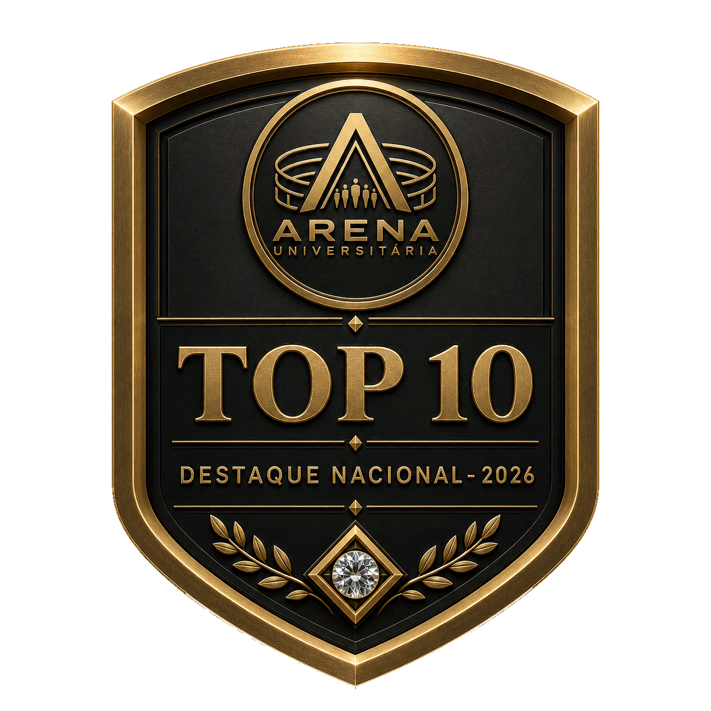
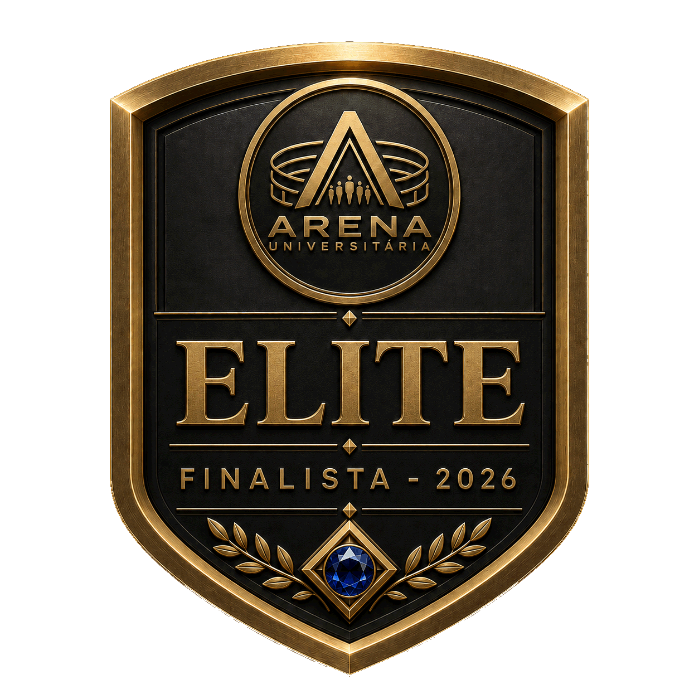

  

  <strong>Graduando em Engenharia da Computação no IFMA · Técnico em Informática</strong>

  <a href="https://catalogo-de-projetos.vercel.app/">Meu portfólio ↗</a> ·
  <a href="#linguagens-e-tecnologias">Tecnologias</a> ·
  <a href="#projetos">Projetos</a> ·
  <a href="#conquistas">Conquistas</a> ·
  <a href="#contato">Contato</a>

---

Sou **José Willians**. Gosto de transformar necessidades do dia a dia em soluções digitais claras e úteis.

Do atendimento acadêmico no WhatsApp a cardápios digitais, experiências web e ferramentas de gestão, meus projetos conectam **pessoas, informação e tecnologia**. Tenho uma base em suporte de TI e sigo ampliando minha prática em desenvolvimento.

## Linguagens e tecnologias

  
  
  
  
  
  

  
  
  
  
  
  

**Dados e serviços:** MySQL · PostgreSQL · Supabase · Cloudinary · Contentful 
**Publicação:** Vercel · GitHub Pages 
**Em aprendizado contínuo:** Python e visão computacional com OpenCV.

## Competências

| Hard skills — o que construo | Soft skills — como trabalho |
| :--- | :--- |
| Interfaces web responsivas com React, HTML e CSS | Comunicação clara e atenção a quem vai usar |
| Chatbots e organização de fluxos conversacionais | Organização e documentação |
| Integração com APIs e bancos de dados | Trabalho em equipe |
| Versionamento com Git/GitHub e ambientes com Docker | Resolução de problemas e pensamento analítico |
| Suporte técnico e configuração de computadores Windows/Linux | Proatividade e aprendizado contínuo |

## Projetos

<table>
  <tr>
    <td width="50%" valign="top">
      <h3>01 · FiraBot</h3>
      
Atendimento acadêmico no WhatsApp para a comunidade do IFMA Santa Inês, com menus guiados e acesso a informações e documentos.

      
TypeScript · Node.js · Baileys · MySQL

      <a href="https://github.com/JoseWillians/firabot-v7-prod">Explorar código ↗</a>
    </td>
    <td width="50%" valign="top">
      <h3>02 · Oba Brownie</h3>
      
Cardápio digital com carrinho, cupons e pedidos pelo WhatsApp, além de recursos de gestão da loja.

      
JavaScript · Supabase · Cloudinary

      <a href="https://oba-brownie.github.io/cardapio-oba-brownie-v2/">Ver o site ↗</a> ·
      <a href="https://github.com/Oba-Brownie/cardapio-oba-brownie-v2">Código</a>
    </td>
  </tr>
  <tr>
    <td width="50%" valign="top">
      <h3>03 · Nosso Amor</h3>
      
Uma experiência personalizada com galeria de memórias, música, contador do relacionamento e carta interativa.

      
React · Vite · Contentful · Vercel

      <a href="https://nosso-amor-gamma.vercel.app/">Ver o site ↗</a> ·
      <a href="https://github.com/JoseWillians/meu-amor-site">Código</a>
    </td>
    <td width="50%" valign="top">
      <h3>04 · Sistema PDV</h3>
      
Projeto de gestão para uma loja de cosméticos, com cadastros, controle de estoque e dashboard. Em desenvolvimento.

      
React · TypeScript · Express · PostgreSQL

      <a href="https://catalogo-de-projetos.vercel.app/#projetos">Conhecer no portfólio ↗</a>
    </td>
  </tr>
</table>

## Conquistas

**Arena Universitária · 2026**

Minha participação no evento rendeu estes reconhecimentos:

  
  
  

<strong>1º lugar estadual · Top 10 nacional · Elite — finalista</strong>

  
<strong>Um pouco do meu processo</strong>

   

  1. **Entender a necessidade:** ouvir, fazer perguntas e definir o problema.
  2. **Organizar o caminho:** dividir a ideia em entregas pequenas.
  3. **Construir com cuidado:** pensar na experiência de quem vai usar.
  4. **Revisar e evoluir:** documentar decisões e melhorar a solução.

  
<strong>O que você encontra por aqui</strong>

   

  - Projetos de desenvolvimento web e automação.
  - Aplicações que aproximam pessoas e informações.
  - Experimentos e aprendizado em Engenharia da Computação.

## Contato

Vamos conversar sobre tecnologia, projetos ou uma ideia que precisa sair do papel.

**[Portfólio ↗](https://catalogo-de-projetos.vercel.app/)** ·
**[E-mail](mailto:josewilliansdesouza@gmail.com)** ·
**[Instagram · @j_willians.c](https://instagram.com/j_willians.c)**

---

José Willians · Ideias que viram projetos.

